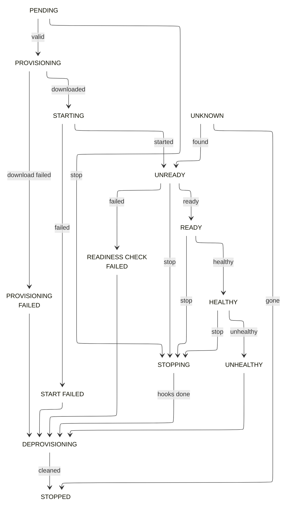

# Application Instances

Application instances are running containers for an application. The state machine for instances are managed in a decentralised manner on the cluster nodes locally and not by the controllers. This includes running health checks, readiness checks and shutdown hooks on the container, container loss detection and container state recovery on executor service restart.

Regular updates about the instance state are provided by executors to the controllers and are used to keep the application state up-to-date or trigger application operations to bring the applications to stable states.

## Application Instance States
An application instance can be in one of the following states at one point in time:

* **PENDING** - Container state machine start has been triggered.
* **PROVISIONING** - Docker image is being downloaded
* **PROVISIONING_FAILED** - Docker image download failed
* **STARTING** - Docker run is being executed
* **START_FAILED** - Docker run failed
* **UNREADY** - Docker started, readiness check not yet started.
* **READINESS_CHECK_FAILED** - Readiness check was run and has failed terminally
* **READY** - Readiness checks have passed
* **HEALTHY** - Health check has passed. Container is running properly and passing regular health checks
* **UNHEALTHY** - Regular health check has failed. Container will stop.
* **STOPPING** - Shutdown hooks are being called and docker kill be be issued
* **DEPROVISIONING** - Docker image is being cleaned up
* **STOPPED** - Docker stop has completed
* **LOST** - Container has exited unexpectedly while executor service was down
* **UNKNOWN** - All running containers are in this state when executor service is getting restarted and before startup recovery has kicked in

## Application Instance State Machine

Instance state machine transitions might be triggered on receipt of commands issued by the controller or due to internal changes in the container (might have died or started failing health checks) as well as external factors like executor service restarts.

The outline color shows the state category. Gray marks the start state. Purple marks the terminal state. Red marks error states. Green marks the steady state. Yellow marks transient states.

!!!note
    An instance never moves to `LOST` through a transition in this state machine. The executor marks an instance as `LOST` when the container stops while the executor service is down.

!!!note
    No operations are allowed to be performed on application instances directly through the executor
