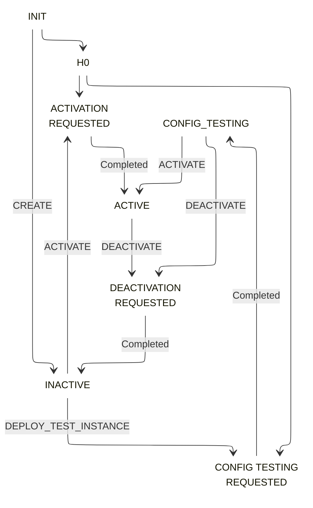
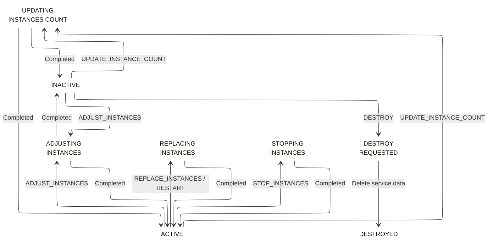

# Introduction

A **local service** is a virtual representation of a node-level service workload in the cluster.

Typical use cases include:

- metrics collectors
- DNS/cache resolvers
- node-level agents
- security and compliance sidecars

Running containers for a local service are called **local service instances**.

A local service **specification** contains details such as:

- name and version
- executable container coordinates
- exposed ports
- resources
- placement policy (`LOCAL` only)
- health and readiness checks
- pre-shutdown hooks
- environment variables
- volumes and configs
- logging details
- tags

## Primary differences with applications and tasks

- Local services are designed for executor-level deployment patterns instead of user-facing service exposure.
- Local services only support `LOCAL` placement policy.
- `LOCAL` placement can be configured with `hostLevel=true` to bind service ports to fixed host ports.
- Local services maintain `instancesPerHost`, unlike applications which maintain a cluster-wide required instance count.
- Local services support activation and deactivation flows (`ACTIVE`, `INACTIVE`, `CONFIG_TESTING`) in addition to lifecycle states.
- Tasks are transient and short-lived; local services are long-running infrastructure workloads.

## Local Service ID

Once a local service is created on the cluster, a local service id is generated. The current format is `{name}-{version}`. All subsequent operations use this id.

## Local Service States and Operations

Local services follow a fixed lifecycle modelled as a state machine. State transitions are triggered by operations issued by users/systems and by instance-level health/reconciliation behavior.

### Local service states

At service level, local services can move through states such as:

- `INIT`
- `ACTIVATION_REQUESTED`
- `CONFIG_TESTING_REQUESTED`
- `DEACTIVATION_REQUESTED`
- `EMERGENCY_DEACTIVATION_REQUESTED`
- `INACTIVE`
- `ACTIVE`
- `CONFIG_TESTING`
- `ADJUSTING_INSTANCES`
- `DEPLOYING_TEST_INSTANCE`
- `REPLACING_INSTANCES`
- `STOPPING_INSTANCES`
- `UPDATING_INSTANCES_COUNT`
- `DESTROY_REQUESTED`
- `DESTROYED`

### Activation state

In addition to lifecycle state, every local service has an activation state:

- `ACTIVE`
- `CONFIG_TESTING`
- `INACTIVE`

!!!note
    `EMERGENCY_DEACTIVATION_REQUESTED` is a safety state entered by the controller in specific cancellation/failure paths. In this state, controller drives the service toward deactivation.

### Local service operations

The following operations are supported:

- `CREATE`
- `ACTIVATE`
- `DEACTIVATE`
- `RESTART`
- `ADJUST_INSTANCES`
- `DEPLOY_TEST_INSTANCE`
- `REPLACE_INSTANCES`
- `STOP_INSTANCES`
- `UPDATE_INSTANCE_COUNT`
- `DESTROY`

!!!tip
    Use [Drove CLI](../cli/index.md) for manual operations and API payloads for automation/integration workflows.

### Local service state machine

The full state machine allows many transitions for error and cancellation paths. The diagrams below show the basic flows only. Each arrow shows the operation or the result that triggers the move.

#### Activation states

The following diagram shows the normal activation and deactivation flow between the steady states `INACTIVE`, `CONFIG_TESTING`, and `ACTIVE`.

The outline color shows the state category. Gray marks the start state. Green marks steady states. Yellow marks transient states.

!!!note
    `EMERGENCY_DEACTIVATION_REQUESTED` is not shown. The controller enters this error state from instance management states when a job is cancelled. It then moves the service to `DEACTIVATION_REQUESTED`.

#### Instance management states

The following diagram shows instance management operations from the steady states, and the destroy flow. Operations are issued from `ACTIVE`, `INACTIVE`, or `CONFIG_TESTING`. Each operation returns to a steady state when it completes.

The outline color shows the state category. Green marks steady states. Yellow marks transient states. Purple marks the terminal state.

!!!note
    The complete transition table is defined in the controller. `EMERGENCY_DEACTIVATION_REQUESTED` is entered when an instance management job is cancelled while the service is active. It is not shown in the diagram.

!!!note
    A local service never moves to `DEPLOYING_TEST_INSTANCE` through a transition in this state machine. The state exists for the test instance deployment flow.
