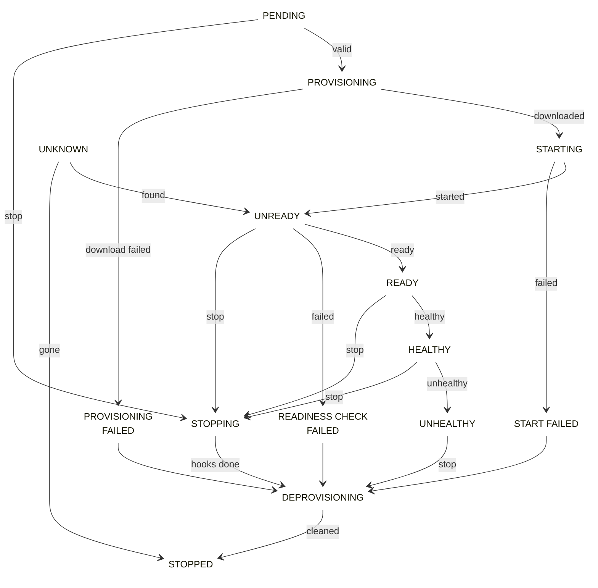

# Local Service Instances

Local service instances are running containers for a local service. The instance state machine is managed in a decentralized manner on executor nodes, including readiness/health checks, shutdown hooks, crash handling, and recovery during executor restart.

Regular instance-state updates are sent by executors to controllers and are used to keep local service state up to date.

Each instance is represented by:

- `serviceId`
- `serviceName`
- `instanceId`
- `executorId`
- local networking details (`localInfo`)
- allocated resources
- current state
- metadata and errors

## Local Service Instance States

A local service instance can be in one of the following states:

- **PENDING** - instance creation started.
- **PROVISIONING** - image pull and provisioning in progress.
- **PROVISIONING_FAILED** - image provisioning failed.
- **STARTING** - container start in progress.
- **START_FAILED** - container start failed.
- **UNREADY** - container started but readiness not achieved yet.
- **READINESS_CHECK_FAILED** - readiness checks failed terminally.
- **READY** - readiness checks passed.
- **HEALTHY** - periodic health checks passing.
- **UNHEALTHY** - health checks failing.
- **DEPROVISIONING** - teardown in progress.
- **STOPPING** - shutdown hooks and stop flow in progress.
- **STOPPED** - instance stopped (terminal).
- **LOST** - instance lost while executor/controller reconciliation happened.
- **UNKNOWN** - temporary state during restart/reconciliation windows.

## Active and old instances

- Active instances are available through `/apis/v1/localservices/{id}/instances`.
- Historical/terminated instances are available through `/apis/v1/localservices/{id}/instances/old`.

Use old instance records for debugging startup failures, reconciliation losses, or repeated health-check failures.

## Instance state machine

Lifecycle transitions are driven by:

- local service operations (`RESTART`, `REPLACE_INSTANCES`, `STOP_INSTANCES`)
- executor lifecycle events (restart/unavailability)
- readiness and health-check outcomes

### Local Service Instance State Machine

Instance state transitions can be triggered by controller-issued commands, internal container changes (for example process exits or failed checks), and external factors such as executor restarts.

The outline color shows the state category. Gray marks the start state. Purple marks the terminal state. Red marks error states. Green marks the steady state. Yellow marks transient states.

!!!note
    An instance never moves to `LOST` through a transition in this state machine. The executor marks an instance as `LOST` when the container stops while the executor service is down.

!!!note
    No operations are allowed directly against local service instances through executor APIs. Use controller APIs/CLI.
