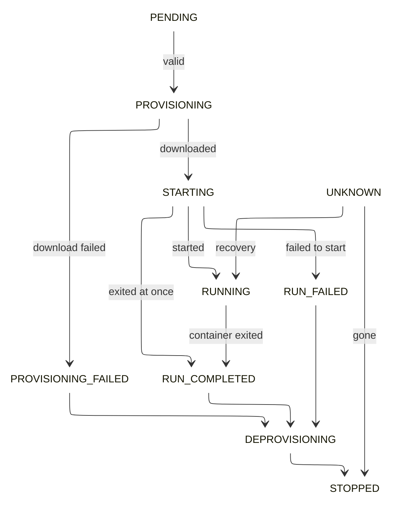

# Introduction
A **task** is a representation for transient containerized workloads on the cluster. A task instance is _supposed_ to have a much shorter life-time than an application instance. Use tasks to spin up things like automation scripts etc.

## Primary differences with an application

Please note the following important differences between a task instance and application instances

* Tasks **cannot expose ports** and virtual hosts for incoming traffic
* There are **no** readiness checks, health checks or shutdown hooks for a task
* Task instances **cannot be scaled** up or down
* Tasks cannot be **restarted**
* A task is typically **owned** by an application running on the cluster.
* Task instances are **not replaced** if the corresponding executor node goes down during execution
* Unlike applications there is no task + task instance, the only representation of task on a Drove cluster is a task instance.

!!!tip
    Use [**epoch**](https://github.com/PhonePe/epoch){:target="_blank"} to spin up tasks in a periodic manner

A **task specification** contains the following sections:

- **Source App Name** - Name of the application that created this task
- **Task ID** - User supplied task ID unique in the same `sourceAppName` scope
- **Executable** - The container to deploy on the cluster
- **Resources** - CPU and Memory required for the container
- **Placement Policy** - How containers are to be placed in the cluster
- **Environment Variables** - Environment variables and values
- **Volumes** - Volumes to be mounted into the container
- **Configs** - Configs/files to be mounted into the container
- **Logging details** - Logging spec (for example rsyslog server)
- **Tags** - A map of strings for additional metadata

## Task ID
Identification of a task is a bit more complicated on Drove. There is a **Task ID** (`{sourceAppName}-{taskId}`) which is used internally in drove. This is returned to the client when task is created.

However, clients are supposed to use the `{sourceAppName,taskId}` combo they have sent in the task spec to address and send commands to their tasks.

## Task States and operations
Tasks on Drove have their own life cycle modelled as a state machine. State transitions can be triggered by issuing operations using the APIs.

### States
Tasks on a Drove cluster can be one of the following states:

- **PENDING** - Task has been submitted, yet to be provisioned
- **PROVISIONING** - Task is assigned to an executor and the container image is downloaded
- **PROVISIONING_FAILED** - Container image download failed. This is an error state.
- **STARTING** - Docker run is starting
- **RUNNING** - Task is running currently
- **RUN_COMPLETED** - Task run has completed. Whether the task passed or failed must be checked from the task result.
- **RUN_FAILED** - The container exited with a failure. This is an error state.
- **DEPROVISIONING** - Container image cleanup underway
- **STOPPED** - Task cleanup completed. This is a terminal state.
- **LOST** - Task disappeared while executor was down. This is a terminal state.
- **UNKNOWN** - All tasks that are running are put in this state when executor has been restarted and startup recovery has not kicked in yet

### Operations
The following task operations are recognized by Drove:

- **CREATE** - Create a task. The Task definition/spec is provided as an argument to this.
- **KILL** - Kill a task. The task ID is taken as a parameter.

!!!tip
    All operations need Cluster Operation Spec which can be used to control the timeout and parallelism of tasks generated by the operation.

### Task State Machine

The following state machine signifies the states and transitions as affected by cluster state and operations issued.

The outline color shows the state category. Gray marks the start state. Purple marks the terminal state. Red marks error states. Green marks the steady state. Yellow marks transient states.

!!!note
    A task never moves to `LOST` through a transition in this state machine. The controller marks a task as `LOST` when its executor does not report the task for a period of time.
